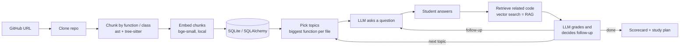

# RepoGrill

[](https://github.com/Adharshan98/repogrill/actions/workflows/ci.yml)

An AI interviewer that reads your GitHub repository and questions you about your own code, the way a real interviewer does in a project deep-dive round. It grades every answer and gives you a scorecard with what to revise.

> Generic mock interviews ask "What is polymorphism?". RepoGrill asks "Your `/login` route returns the user object directly. What fields could that leak?"

## Features
- **Reads any public GitHub repo** and splits it into functions and classes (Python, JavaScript, TypeScript, Java)
- **Code-aware questions** about your actual functions, design choices and edge cases
- **Adaptive follow-ups**: vague or off-topic answers get probed further
- **Instant grading**: a score out of 10 per answer, with what you got right and what you missed
- **Scorecard and study plan**: weakest topics first, with what to revise
- **Voice mode**: answer out loud and hear the questions (browser speech APIs)
- **History**: past interviews are saved; continue unfinished ones any time

## How it works


1. **Read**: clones the repo and splits the code into chunks, one per function or class. Python uses the built-in `ast` module; JavaScript, TypeScript and Java use tree-sitter (including React arrow components, Express route handlers, and big Java classes split per method). Other languages fall back to line-based chunks.
2. **Understand**: turns each chunk into an embedding with a local model (`BAAI/bge-small-en-v1.5` via fastembed), so code can be searched by meaning.
3. **Interview**: picks the most substantial function from each file (main code before tests) and asks an LLM to question you about it. After each answer, related code is retrieved by vector similarity (RAG), and the LLM decides whether to dig deeper (at most 2 follow-ups per topic).
4. **Grade**: one LLM call grades the answer and decides the follow-up. The scorecard averages scores per topic, and the study plan is generated once and saved.

## Tech stack
| Part | Tech |
|---|---|
| Frontend | React 19, Vite, Tailwind CSS, Web Speech API |
| Backend | Python 3.10, FastAPI, SQLAlchemy, SQLite |
| Code analysis | Python `ast`, tree-sitter (JS / TS / Java) |
| AI | fastembed (local embeddings), Groq LLM API (`openai/gpt-oss-120b`) |
| DevOps | Docker (multi-stage build), GitHub Actions CI (tests, lint, build, container smoke test) |

## Run it locally

**1. Backend**
```bash
cd backend
python -m venv .venv
.venv\Scripts\activate          # macOS/Linux: source .venv/bin/activate
pip install -r requirements.txt
copy .env.example .env          # macOS/Linux: cp; then put your Groq API key in .env
uvicorn app.main:app --reload
```
API docs: <http://127.0.0.1:8000/docs>

**2. Frontend** (in a second terminal)
```bash
cd frontend
npm install
npm run dev
```
Open <http://localhost:5173>

**Run the tests**
```bash
cd backend
pip install -r requirements-dev.txt
pytest
```

## Run with Docker
One container serves the website at `/` and the API at `/api`.
```bash
docker build -t repogrill .
docker run -p 8000:8000 -e GROQ_API_KEY=your-key -v repogrill-data:/app/data repogrill
```
Open <http://localhost:8000>

## API
| Method | Endpoint | What it does |
|---|---|---|
| POST | `/analyze` | Clone and index a repo |
| GET | `/repos/{id}/search?q=` | Search the repo's code by meaning |
| POST | `/repos/{id}/interviews` | Start an interview |
| POST | `/interviews/{id}/answer` | Answer the current question; get feedback and the next question |
| GET | `/interviews` | List past interviews |
| GET | `/interviews/{id}` | Full interview with answers and scores |
| GET | `/interviews/{id}/scorecard` | Scores per topic and a study plan |
